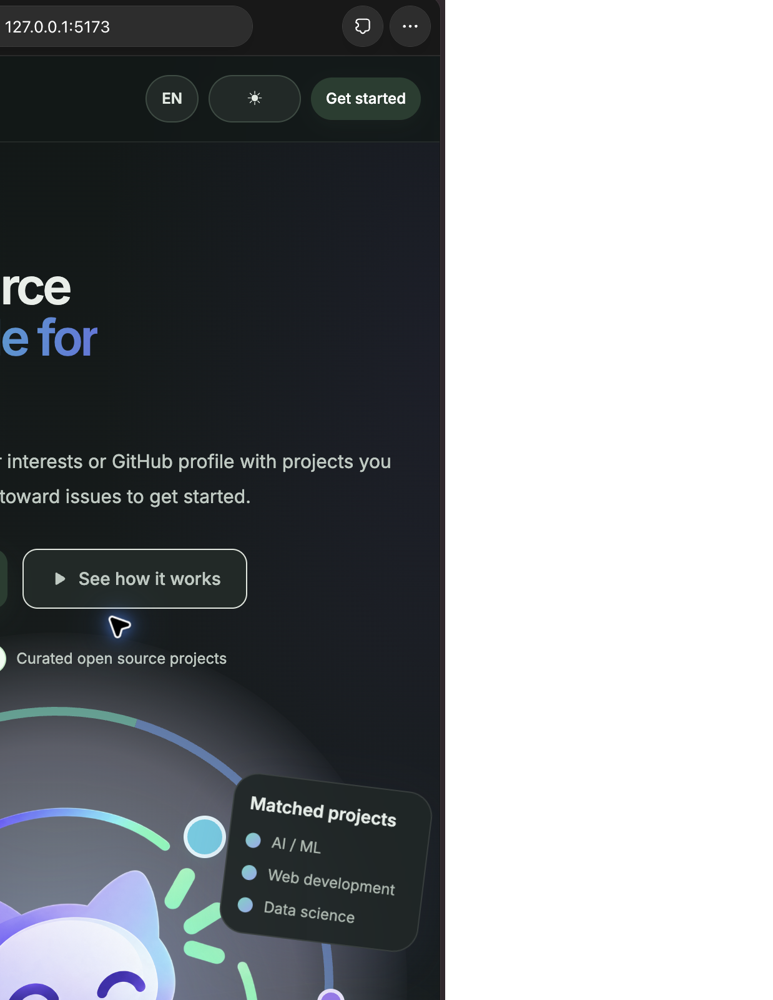

# Op3nSRC

Op3nSRC recommends open-source projects and issues based on a GitHub profile or interests you enter.

🌐 Live Website: https://op3nsrc-web.onrender.com/



## Run it locally

You need Python 3.10+, Node.js, npm, and a GitHub token. Open two terminal windows in the project folder.

### 1. Install Python packages and add your token

```bash
python3 -m venv ml/.venv
source ml/.venv/bin/activate
python -m pip install -r ml/requirements.txt -r server/requirements.txt
cp ml/.env.example ml/.env
```

Open `ml/.env` and set `GITHUB_TOKEN=your_token`. A GitHub token with no extra scopes is enough for public data. Keep this file private; it is not part of the project files to commit.

### 2. Collect the recommendation dataset

The dataset is not included in Git. In the same terminal, run:

```bash
cd ml
python data_collection/main.py
python data_collection/clean.py
cd ..
```

Collection can take around 30 minutes and can be resumed by running the collection command again. Cleaning builds the local files under `ml/data/cleaned/`.

### 3. Start the API

In terminal 1, from the project folder (with `ml/.venv` activated):

```bash
uvicorn app.main:app --app-dir server --reload --host 127.0.0.1 --port 8000
```

Check that it is ready at <http://127.0.0.1:8000/health>.

### 4. Start the website

In terminal 2, from the project folder:

```bash
cd client
npm install
npm run dev -- --host 127.0.0.1
```

Open <http://127.0.0.1:5173>. The website calls the local API at port 8000 by default.

## Optional: save recommendations from the interests form

The GitHub profile form works without a database. Saving manual interests requires PostgreSQL. Install and start PostgreSQL, create a database, then set `DATABASE_URL` in `ml/.env` (for example, `postgresql:///manual_recommendations`). The API creates its table when the first interests request is submitted. See [`server/README.md`](server/README.md).

## Troubleshooting

- **“ML dataset is not available”**: finish the collection and cleaning steps above.
- **GitHub authentication or rate-limit errors**: check the token in `ml/.env`; rerun collection to resume.
- **A GitHub profile has no personal README**: use the interests form, or add a README to a repository named `your-username/your-username`.
- **“Manual recommendations need PostgreSQL”**: configure `DATABASE_URL` as described above, or use the GitHub profile form.
- **Website says “Failed to fetch”**: make sure the API is running and `/health` opens before submitting.

More detail: [data collection](ml/data_collection/README.md) · [API setup](server/README.md).
